# KỊCH BẢN DEMO QUY TRÌNH CHUẨN KHÉP KÍN (END-TO-END)
## TỪ MUA HÀNG $\rightarrow$ DUYỆT $\rightarrow$ NHẬP KHO $\rightarrow$ XUẤT CẤP $\rightarrow$ SẢN XUẤT $\rightarrow$ BÁN HÀNG $\rightarrow$ TRẠM CÂN $\rightarrow$ BẢO TRÌ MỎ ĐÁ HOÀNG PHÚC

> **Mục tiêu tài liệu**: Cung cấp một kịch bản demo mẫu liên hoàn, liền mạch 100% từ đầu vào đến đầu ra theo chuỗi giá trị sản xuất kinh doanh mỏ đá, giúp đội ngũ triển khai trình diễn thuyết phục trước Ban Lãnh Đạo và các phòng ban chuyên môn.

---

### THÔNG TIN MÔI TRƯỜNG THỰC THI DEMO
- **Hệ thống**: Odoo Enterprise Edition (Bộ module chuyên ngành mỏ Hoàng Phúc)
- **Địa chỉ truy cập**: Updating..
- **Cơ sở dữ liệu**: `hoangphuc_db`
- **Tài khoản đăng nhập**: `admin` / `admin`

---

## SƠ ĐỒ CHUỖI GIÁ TRỊ VẬN HÀNH LIÊN HOÀN MỎ ĐÁ

```mermaid
flowchart TD
    subgraph MUA_HANG["1. Mua Sắm & Duyệt (Purchasing)"]
        A[Lập Đơn Mua Phụ Tùng / Vật Tư] --> B{Phân Cấp Duyệt BR-03}
        B -->|<= 20 Triệu| C[TGĐ Phê Duyệt]
        B -->|> 20 Triệu| D[Chủ Tịch HĐQT Duyệt]
    end

    subgraph KHO_NHAP["2. Nhập Kho & Nghiệm Thu (GRN)"]
        C --> E[Phiếu Nhập Kho Receipt]
        D --> E
        E --> F[Nghiệm Thu Hiện Trường BR-05]
        F --> G[Tạo Hóa Đơn NCC Vendor Bill]
    end

    subgraph XUAT_CAP["3. Xuất Cấp Vật Tư & VLNCN"]
        G --> H[Xuất Phụ Tùng Gắn Xe Máy BR-10]
        H --> I[Xuất Kho VLNCN Theo Hộ Chiếu Nổ Mìn]
    end

    subgraph SAN_XUAT["4. Sản Xuất Trạm Nghiền (MRP)"]
        I --> J[Kiểm Tra An Toàn Đầu Ca BR-02]
        J --> K[Cấp Liệu Đá Thô Moong Mỏ Luồng 4B]
        K --> L[Nghiền Sàng & Kiểm Soát Downtime BR-04]
        L --> M[Bàn Giao Thành Phẩm Nhập Bãi Luồng 4.5]
    end

    subgraph BAN_HANG["5. Bán Hàng & Thu Hồi Nợ (Sales)"]
        M --> N[Đơn Hàng Dự Án Cao Tốc / Cầu Đường]
        N --> O{Kiểm Tra Ký Quỹ & Nợ BR-01, 02}
        O -->|Đủ Tiền / Hạn Mức| P[Xác Nhận Đơn Hàng SO]
    end

    subgraph TRAM_CAN["6. Cân Xe & Giao Hàng (Scale)"]
        P --> Q[Lệnh Giao Hàng Stock Picking]
        Q --> R[Trạm Cân: Cân Bì & Cân Tổng Xe Howo]
        R --> S[Tự Động Tính Tịnh & Quy Đổi m3]
        S --> T[In Phiếu Cân Xe Điện Tử Song Ngữ]
        T --> U[Xuất Kho & Lập Hóa Đơn Khách Hàng]
    end

    subgraph BAO_TRI["7. Quản Lý Thiết Bị & Bảo Trì"]
        U --> V[Nhật Ký Cấp Dầu & Cảnh Báo >10% BR-08]
        V --> W[Sự Cố Dừng Máy >= 10 Phút BR-04]
        W --> X[Biên Bản Nghiệm Thu 3 Bên Mở Máy BR-07]
    end

    style MUA_HANG fill:#e3f2fd,stroke:#1565c0,stroke-width:2px
    style KHO_NHAP fill:#e8f5e9,stroke:#2e7d32,stroke-width:2px
    style XUAT_CAP fill:#fff3e0,stroke:#ef6c00,stroke-width:2px
    style SAN_XUAT fill:#f3e5f5,stroke:#7b1fa2,stroke-width:2px
    style BAN_HANG fill:#e0f2f1,stroke:#00695c,stroke-width:2px
    style TRAM_CAN fill:#fffde7,stroke:#fbc02d,stroke-width:2px
    style BAO_TRI fill:#fbe9e7,stroke:#d84315,stroke-width:2px
```

---

## BẢNG TỔNG HỢP TIẾN TRÌNH DEMO (TIMELINE)

| Bước | Phân hệ nghiệp vụ | Thao tác chính | Business Rule kiểm soát | Thời lượng |
| :---: | :--- | :--- | :--- | :---: |
| **1** | Mua hàng (Purchase) | Lập đơn mua răng gầu máy xúc / lốp xe Howo | Gắn đích danh xe (`equipment_id` - **BR-10**), So sánh 3 báo giá (**BR-02**) | 2 phút |
| **2** | Kiểm duyệt (Approval) | Trình duyệt đa cấp thẩm quyền tài chính | $\le 20M$: TGĐ duyệt; $> 20M$: Chủ tịch HĐQT duyệt (**BR-03**) | 2 phút |
| **3** | Nhập kho (Receipt) | Nhận hàng, nghiệm thu hiện trường, tạo Bill | Nghiệm thu moong/xưởng (**BR-05**), đối soát công nợ 1 tháng (**BR-08**) | 2 phút |
| **4** | Xuất cấp (Stock Picking) | Cấp phụ tùng cho máy xúc, cấp thuốc nổ | Gắn hộ chiếu nổ mìn, hạn mức kho VLNCN an toàn | 2 phút |
| **5** | Kiểm tra an toàn (Safety) | Kiểm tra điều kiện trạm nghiền đầu ca | Bắt buộc an toàn mới cho chạy trạm (**BR-02**) | 1 phút |
| **6** | Sản xuất (MRP) | Cấp liệu đá thô moong, chạy trạm nghiền, xử lý dừng máy | Áp khối lượng cấp liệu, dừng máy $\ge 10$ phút giải trình (**BR-04**) | 3 phút |
| **7** | Bán hàng (Sales) | Bán đá cho Dự án Cao tốc Bắc Nam | Cảnh báo ký quỹ, chặn xuất đá nếu chưa nộp cọc (**BR-01, BR-02**) | 2 phút |
| **8** | Cân xe (Scale Station) | Cân xe Howo, tính tịnh, quy đổi $m^3$, in phiếu cân | Tỷ trọng $1.55$ tấn/$m^3$, in phiếu cân song ngữ, hoàn tất giao hàng | 3 phút |
| **9** | Bảo trì & Cấp dầu (Maint) | Đối soát tiêu hao dầu DO, nghiệm thu 3 bên | Cảnh báo đỏ vượt định mức $>10\%$ (**BR-08**), ký 3 bên mở máy (**BR-07**) | 3 phút |

---

## CHI TIẾT 9 BƯỚC THAO TÁC DEMO THỰC TẾ

### BƯỚC 1: MUA SẮM VẬT TƯ & GẮN ĐÍCH DANH THIẾT BỊ MỎ (BR-10)
> **Mục tiêu**: Chứng minh khả năng kiểm soát chi phí mua sắm theo từng xe/máy mỏ và chống chỉ định thầu tùy tiện.

1. Vào menu **Mua hàng (Purchase)** $\rightarrow$ **Đơn Mua Hàng (Purchase Orders)**.
2. Mở đơn mua hàng có sẵn: **`P00001`** (hoặc bấm *Tạo mới*).
   - **Nhà cung cấp**: *Công Ty Phụ Tùng Cơ Giới Đức Soạn*.
   - **Thiết bị chịu chi phí (BR-10)**: Chọn `Máy Xúc Đào Komatsu PC450-8 (EX-01)`.
   - **Sản phẩm**: `Răng Gầu Máy Xúc Komatsu PC450` (10 cái $\times$ 1.450.000 VNĐ = **14.500.000 VNĐ**).
3. Tab **"Quy Tắc 3 Báo Giá & Chỉ Định Thầu (BR-02)"**:
   - Nếu mua 1 nguồn duy nhất $\rightarrow$ tick chọn *Mua 1 Nguồn Duy Nhất (Chỉ Định Thầu)* $\rightarrow$ Bắt buộc phải có giải trình kỹ thuật: *"Phụ tùng chính hãng Komatsu từ đại lý độc quyền Bắc Trung Bộ"*.
4. **Điểm nhấn thuyết trình (Talking Point)**:
   > *"Thưa Ban Lãnh Đạo, Odoo giúp Hoàng Phúc chấm dứt tình trạng mua vật tư chung chung. Mọi phụ tùng mua về đều được gắn đích danh xe máy chịu chi phí theo BR-10 để phục vụ tính giá thành ca máy tự động."*

---

### BƯỚC 2: PHÊ DUYỆT ĐA CẤP THEO THẨM QUYỀN TÀI CHÍNH (BR-03)
> **Mục tiêu**: Thể hiện phân cấp thẩm quyền tài chính rõ ràng giữa Tổng Giám Đốc và Chủ Tịch HĐQT.

1. **Trường hợp A: Đơn hàng $\le 20.000.000$ VNĐ (Đơn `P00001` - 14.5 Triệu)**:
   - Hệ thống tự động gắn nhãn: **"Cấp 1: <= 20 Triệu (TGĐ Phê Duyệt)"**.
   - Người lập nhấn **"Trình Phê Duyệt"** $\rightarrow$ Trạng thái chuyển *Chờ TGĐ Phê Duyệt*.
   - Đăng nhập quyền TGĐ: Bấm nút **"TGĐ Phê Duyệt"** $\rightarrow$ Chuyển thẳng sang *Đã Phê Duyệt Thẩm Quyền*.
   - Bấm **"Xác Nhận Đơn Hàng" (Confirm Order)**.
2. **Trường hợp B: Đơn hàng $> 20.000.000$ VNĐ (Đơn `P00002` - 45 Triệu mua lốp Howo)**:
   - Hệ thống tự động phân cấp: **"Cấp 2: > 20 Triệu (Chủ Tịch HĐQT Phê Duyệt)"**.
   - Tab 3 Báo giá có đủ so sánh: Tiến Lốp (45M), Phụ Tùng Nam Định (48.5M), Lốp Hà Nội (49M).
   - TGĐ bấm **"TGĐ Phê Duyệt"** $\rightarrow$ Hệ thống ghi nhận TGĐ đã soát xét và tự động đẩy lên nút **"Chủ Tịch HĐQT Phê Duyệt"** sáng lên cho Chủ tịch HĐQT chốt quyết định cuối cùng!
3. **Thử nghiệm vi phạm BR-03**:
   - Bấm *Xác Nhận Đơn Hàng* khi chưa duyệt $\rightarrow$ Hệ thống lập tức chặn lại và báo lỗi: *"Đơn hàng chưa được phê duyệt thẩm quyền tài chính (BR-03)!"*

---

### BƯỚC 3: NHẬP KHO VẬT TƯ & ĐỐI SOÁT HÓA ĐƠN 3 BÊN (BR-05)
> **Mục tiêu**: Kiểm soát hàng về thực tế tại moong mỏ, có ảnh chụp bàn giao hiện trường trước khi kế toán thanh toán.

1. Sau khi PO được xác nhận, bấm vào nút thông minh **Nhận Hàng (Receipt)** ở góc trên bên phải đơn PO.
2. Mở phiếu nhập kho (ví dụ `WH/IN/00002`):
   - Kiểm tra dòng sản phẩm: `10 cái Răng Gầu Komatsu PC450`.
   - Cột **Trạng Thái (State)** hiển thị rõ ràng huy hiệu màu xanh dương: `Sẵn sàng (Ready)`.
3. Tab **"Nghiệm Thu Bàn Giao Hiện Trường (BR-05)"**:
   - Tick chọn: *Đã Nghiệm Thu Hiện Trường*.
   - Người nghiệm thu: Quản đốc xưởng cơ điện hoặc Lái máy xúc `EX-01`.
   - Đính kèm ảnh chụp thực tế phụ tùng bàn giao tại bãi moong.
4. Bấm nút **Xác thực (Validate)** $\rightarrow$ Hoàn tất nhập kho, tồn kho phụ tùng tăng lên 10 cái.
5. Quay lại đơn PO, bấm nút **Tạo hóa đơn (Create Bill)**:
   - Hệ thống tự động tạo **Hóa đơn nhà cung cấp (Vendor Bill)** với Sổ nhật ký Mua hàng `BILL`.
   - Thực hiện quy trình đối soát 3 chiều: **Đơn mua (PO) - Phiếu kho thực nhận (GRN) - Hóa đơn NCC (Bill)**.

---

### BƯỚC 4: XUẤT CẤP PHỤ TÙNG & VẬT LIỆU NỔ KHAI THÁC MỎ
> **Mục tiêu**: Xuất phụ tùng thay thế trực tiếp cho xe máy và xuất VLNCN theo hộ chiếu an toàn.

1. **Xuất phụ tùng thay thế cho Máy xúc `EX-01`**:
   - Vào **Kho vận (Inventory)** $\rightarrow$ **Phiếu Giao Hàng / Chuyển Kho**.
   - Mở phiếu xuất kho vật tư phụ tùng `KVT/OUT/00001` (Kho Vật Tư KVT).
   - Thiết bị nhận phụ tùng: `Máy Xúc Đào Komatsu PC450-8 (EX-01)`.
   - Xuất cấp: 2 răng gầu mới để thay thế răng gầu mòn $\rightarrow$ Bấm **Xác thực (Validate)**.
2. **Xuất kho Vật Liệu Nổ Công Nghiệp (VLNCN)**:
   - Mở phiếu xuất kho `VLN/OUT/00001` tại Kho Vật Liệu Nổ `VLN`.
   - Kiểm tra thông tin pháp lý bắt buộc:
     * **Mã Hộ Chiếu Nổ Mìn**: `HC-01/2026/ND` (Phương án bạt taluy tầng +45m).
     * **Chỉ Huy Nổ Mìn Chịu Trách Nhiệm**: `Kỹ sư Lê Văn Thắng` (Có chứng chỉ nổ mìn hợp lệ).
     * Sản phẩm: 450 kg *Thuốc Nổ Nhũ Tương*, 120 quả *Kíp Nổ Vi Sai*.
   - Bấm **Xác thực** $\rightarrow$ Sau khi nổ mìn an toàn, tạo ra khối lượng đá hộc sau nổ sẵn sàng cho xúc cấp liệu.

---

### BƯỚC 5: KIỂM DUYỆT AN TOÀN ĐẦU CA TRẠM NGHIỀN (BR-02)
> **Mục tiêu**: Đảm bảo an toàn lao động mỏ đá - kỷ luật cao nhất trước khi bấm nút vận hành trạm nghiền.

1. Vào ứng dụng **Sản xuất (Manufacturing)** $\rightarrow$ **Lệnh Sản Xuất (Manufacturing Orders)**.
2. Mở Lệnh sản xuất ca chiều: **`WH/MO/00002`**:
   - Trạm nghiền: `Trạm Nghiền Sàng 1 (Công suất 250 Tấn/h)`.
   - Ca làm việc: `Ca 2 (14:00 - 22:00)`.
   - Trưởng ca vận hành: `Trần Văn Cường`.
3. Mở tab **"Điều Hành Trạm Nghiền Mỏ"**:
   - Kiểm tra ô chọn: **Đã Kiểm Tra An Toàn Đầu Ca (BR-02)**.
   - Cán bộ an toàn hiện trường: `Nguyễn Văn An (Giám sát An toàn Mỏ)`.
4. **Trình diễn kịch bản vi phạm BR-02**:
   - Bỏ tick chọn *Đã Kiểm Tra An Toàn Đầu Ca* và bấm nút Xác nhận lệnh $\rightarrow$ Hệ thống lập tức quăng cảnh báo đỏ:
     > *"CẢNH BÁO BR-02: Điều kiện an toàn đầu ca chưa được xác nhận! Nghiêm cấm phát lệnh vận hành trạm nghiền."*
   - Tick chọn lại an toàn $\rightarrow$ Cho phép chạy lệnh sản xuất bình thường.

---

### BƯỚC 6: SẢN XUẤT MỎ ĐÁ, DỪNG MÁY DOWNTIME & NHẬP BÃI THÀNH PHẨM (BR-04)
> **Mục tiêu**: Cấp liệu moong mỏ, kiểm soát thời gian dừng máy và tự động nhập kho bãi thành phẩm.

1. **Ghi nhận cấp liệu đá thô (Luồng 4B)**:
   - Tại Lệnh sản xuất `WH/MO/00002`:
   - Vị trí khai trường: `Moong Khai Thác Mỏ Núi Dài - Tầng Mức +45m`.
   - Số chuyến xe ben Howo chở lên: `11 Chuyến xe`.
   - Khối lượng đá thô cấp vào phễu: `220.0 Tấn`.
   - Bấm nút **"Áp Đá Thô Cấp Liệu"** trên thanh Header $\rightarrow$ Hệ thống tự động điền `220 Tấn Đá Hộc Khai Thác Mỏ` vào danh sách nguyên liệu tiêu hao!
2. **Kiểm soát dừng máy Downtime (BR-04)**:
   - Thêm dòng vào bảng **Nhật Ký Dừng Máy**: Chọn giờ bắt đầu, kết thúc hoặc nhập trực tiếp Thời lượng = `15 phút`, bỏ trống ô giải trình.
   - Bấm nút Hoàn tất sản xuất $\rightarrow$ Hệ thống cảnh báo đỏ:
     > *"CẢNH BÁO BR-04: Có 1 lượt dừng máy từ 10 phút trở lên chưa có giải trình kỹ thuật! Bắt buộc nhập đầy đủ giải trình sự cố dừng máy trước khi chốt sản xuất!"*
   - Chọn mã nguyên nhân: `Tắc Phễu / Kẹt Đá Quá Cỡ`.
   - Nhập giải trình: *"Kẹt đá tảng >800mm, đã dừng khẩn cấp và dùng búa thủy lực đập nhỏ thông phễu 15 phút."*
3. **Chốt lệnh sản xuất & Bàn giao nhập bãi (Luồng 4.5)**:
   - Điền số lượng hoàn thành: `200 Tấn Đá 1x2 (Đá Bê Tông)`.
   - Bãi nhận thành phẩm: `Bãi Thành Phẩm Đá 1x2 - Moong Chính Cạnh Trạm Cân Số 1`.
   - Bấm **Hoàn tất (Produce All)** $\rightarrow$ Tồn kho bãi Đá 1x2 tự động tăng lên 200 Tấn!

---

### BƯỚC 7: BÁN HÀNG DỰ ÁN & KIỂM SOÁT HẠN MỨC KÝ QUỸ (BR-01, BR-02)
> **Mục tiêu**: Khóa xe bán hàng theo thời gian thực nếu khách hàng chưa nộp cọc hoặc vượt hạn mức nợ.

1. Vào ứng dụng **Bán hàng (Sales)** $\rightarrow$ **Đơn Bán Hàng (Orders)**.
2. Mở đơn hàng mẫu: **`HĐ-47/2026/HP-DA`**:
   - Khách hàng: *Công ty CP Xây Dựng & Cầu Đường 47*.
   - Dự án công trình: `Dự Án Cao Tốc Bắc - Nam (Gói Thầu XL-02)`.
   - Sản phẩm: `Đá 1x2 (Đá Bê Tông)` - Quy cách: Bán theo Tấn.
   - Hạn mức nợ hợp đồng: `500.000.000 VNĐ` - Nợ hiện tại: `280.000.000 VNĐ` $\rightarrow$ Còn khả dụng: `220.000.000 VNĐ`.
   - Báo giá hiển thị huy hiệu xanh an toàn: *"Khách hàng còn trong hạn mức tín dụng"*.
3. **Trình diễn cảnh báo đỏ chặn nợ xấu (BR-02)**:
   - Mở khách hàng *Hợp Tác Xã Vận Tải & VLXD Hải Hòa*: Số dư tiền cọc chỉ còn `3.500.000 VNĐ`.
   - Tạo báo giá 50 tấn đá trị giá 12.000.000 VNĐ $\rightarrow$ Hệ thống lập tức hiện **Cảnh báo đỏ**:
     > *"CẢNH BÁO: Số dư tiền ký quỹ của khách hàng không đủ (Còn 3.500.000 VNĐ)! Không cho phép xác nhận xuất đá."*
4. Quay lại đơn hàng Cao tốc `HĐ-47/2026/HP-DA`, bấm **Xác nhận (Confirm)** $\rightarrow$ Hệ thống sinh **Lệnh giao hàng (Delivery Order)** chuyển sang trạm cân.

---

### BƯỚC 8: CÂN XE ĐIỆN TỬ TRẠM CÂN & IN PHIẾU CÂN MỎ ĐÁ (SÓNG 1 & SÓNG 2)
> **Mục tiêu**: Tránh gian lận khối lượng trạm cân, tự động quy đổi Tấn sang $m^3$ theo tỷ trọng, in phiếu cân song ngữ tức thời.

1. Vào **Kho vận (Inventory)** $\rightarrow$ chọn **Phiếu Giao Hàng (Delivery Orders)**.
2. Mở phiếu giao hàng xuất đá cho xe ben `36C-284.91` (từ đơn hàng cao tốc ở Bước 7).
3. Chuyển sang Tab **"Trạm Cân Mỏ Đá"**:
   - Biển số xe: `36C-284.91`, Lái xe: `Nguyễn Văn Mạnh`.
   - Trạm cân thực hiện: `Trạm Cân Số 1`.
   - Khối lượng xe không tải (Cân Bì): `14,250 Kg`.
   - Khối lượng xe có tải (Cân Tổng): `38,450 Kg`.
   - Tỷ trọng đá 1x2 theo hợp đồng: `1.55 tấn/m³`.
4. **Hệ thống tự động tính toán chính xác**:
   - **Khối Lượng Tịnh**: `24,200 Kg (24.20 Tấn)`.
   - **Thể Tích Quy Đổi**: `15.61 m³` ($=(24.2 / 1.55)$).
5. **Thao tác 2 nút tự động hóa**:
   - **Nút 1: "Áp Khối Lượng Cân"**: Nhấn nút $\rightarrow$ Số lượng `24.20 Tấn` tự động được điền vào chi tiết dòng xuất kho mà thủ kho không cần gõ tay.
   - **Nút 2: "In Phiếu Cân"**: Nhấn nút $\rightarrow$ Hệ thống tải xuống ngay file PDF **Phiếu Cân Xe Điện Tử** song ngữ có đầy đủ thông số bì/tổng/tịnh/$m^3$ và chữ ký lái xe, thủ kho.
6. Bấm nút **Xác thực (Validate)** $\rightarrow$ Hoàn tất xuất kho thành phẩm đá mỏ!

---

### BƯỚC 9: NHẬT KÝ CẤP DẦU, CẢNH BÁO VƯỢT ĐỊNH MỨC & NGHIỆM THU 3 BÊN (BR-07, BR-08)
> **Mục tiêu**: Chặn đứng thất thoát nhiên liệu dầu DO mỏ đá và quản lý kỷ luật chạy thử an toàn máy móc cơ giới.

1. **Kiểm tra Nhật Ký Cấp Dầu DO & Đối soát tiêu hao (BR-08)**:
   - Vào menu **Bảo trì (Maintenance)** $\rightarrow$ **Nhật Ký Cấp Dầu (BR-08)**.
   - Mở phiếu bình thường: Máy xúc `EX-01`: Cấp 320L dầu, chạy 10h $\rightarrow$ Tiêu hao: `32.0 L/h` (Định mức chuẩn: 32.5 L/h $\rightarrow$ Huy hiệu xanh an toàn).
   - Mở phiếu cảnh báo đỏ: Xe ben `36C-315.68`: Cấp 245L dầu, chạy 10h $\rightarrow$ Tiêu hao: `24.5 L/h` (Định mức: 21.0 L/h $\rightarrow$ **Vượt quá +16.7%**!).
   - Hệ thống bật **Cảnh báo đỏ vi phạm BR-08** $\rightarrow$ Bắt buộc phải có văn bản giải trình kỹ thuật: *"Đường moong sình lầy do mưa đêm, xe gài 2 cầu chạy số 1 liên tục..."* mới cho phép lưu phiếu.
2. **Nghiệm thu chạy thử 3 bên trước khi mở khóa máy (BR-07)**:
   - Vào menu **Bảo trì** $\rightarrow$ **Thiết bị (Equipment)** $\rightarrow$ Mở máy xúc `EX-02` (Hitachi Zaxis 350).
   - Máy đang bị **"Khóa Thiết Bị (Không Đạt An Toàn)"** do vừa sửa chữa bục tuy-ô thủy lực.
   - Mở Phiếu sửa chữa máy xúc `EX-02`:
     * Thời gian dừng máy: `45 phút` ($\ge 10$ phút) kèm giải trình kỹ thuật chi tiết theo BR-04.
   - Tab **"Nghiệm Thu 3 Bên (BR-07)"**:
     * 1. Lái xe vận hành thử (OK) + Ghi chú chạy thử 15 phút êm ái.
     * 2. Thợ sửa chữa hoàn thành (OK).
     * 3. Quản đốc mỏ phê duyệt mở máy (OK).
   - Bấm nút **"Nghiệm Thu 3 Bên (BR-07)"** $\rightarrow$ Hệ thống xác nhận đủ 3 bên và tự động mở khóa thiết bị `EX-02` trở lại vận hành an toàn!

---

## TỔNG KẾT BÀI HỌC VẬN HÀNH & GIÁ TRỊ MANG LẠI

1. **Chuỗi quy trình khép kín 100%**: Không có nghiệp vụ nào bị bỏ rời rạc; từ lúc mua bu-lông, răng gầu đến khi nổ mìn, nghiền đá, cân xe xuất bán và bảo dưỡng máy móc đều chạy trên một nền tảng duy nhất.
2. **Kỷ luật số hóa thời gian thực (Zero Leakage)**:
   - Khóa mua sắm nếu chưa phê duyệt tài chính (**BR-03**).
   - Khóa chạy trạm nghiền nếu mất an toàn (**BR-02**).
   - Khóa xuất đá nếu khách hàng chưa nộp tiền cọc (**BR-01**).
   - Khóa lưu phiếu dầu nếu tiêu hao vượt định mức $>10\%$ mà thiếu giải trình (**BR-08**).
   - Khóa mở máy xúc nếu chưa đủ 3 bên nghiệm thu chạy thử (**BR-07**).
3. **Trải nghiệm người dùng vượt trội**: Tự động tính toán từ trạm cân, quy đổi Tấn sang $m^3$, in phiếu cân song ngữ 1 chạm, giúp thủ kho và kế toán tiết kiệm 80% thời gian thao tác giấy tờ.
